<p align="center">
  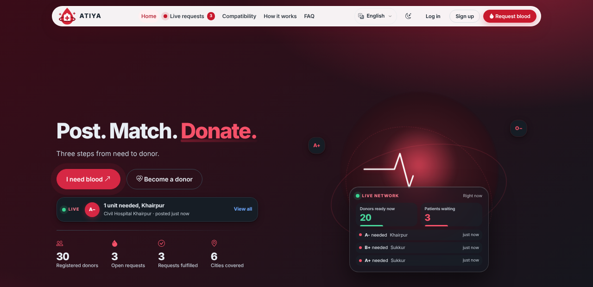
</p>

<h3 align="center">A blood request that a hospital has checked, shown only to donors who can actually help.</h3>

<p align="center">
  <a href="https://harsha01.pythonanywhere.com"></a>
  
  
  
  
  
</p>

<p align="center">
  <a href="#why-atiya">Why</a> ·
  <a href="#one-request-start-to-finish">Flow</a> ·
  <a href="#see-it">Screenshots</a> ·
  <a href="#rules-that-keep-it-safe">Rules</a> ·
  <a href="#design-decisions">Decisions</a> ·
  <a href="#run-it-in-two-minutes">Run it</a> ·
  <a href="#under-the-hood">Under the hood</a> ·
  <a href="#questions-people-ask">FAQ</a>
</p>

<table align="center">
  <tr>
    <td align="center"><b>4</b><br><sub>roles</sub></td>
    <td align="center"><b>9</b><br><sub>hospitals</sub></td>
    <td align="center"><b>3</b><br><sub>languages</sub></td>
    <td align="center"><b>90 days</b><br><sub>automatic rest</sub></td>
    <td align="center"><b>883</b><br><sub>automated tests</sub></td>
  </tr>
</table>

> **A university project** for CSC-206 Software Engineering, Aror University of Art, Architecture, Design & Heritage, Sukkur. ATIYA connects people. It does not store or supply blood and is not a medical service. A hospital or blood bank must always screen the donor.

---

## Why ATIYA

When someone needs blood urgently, the usual route is a WhatsApp message that gets forwarded to fifty people.

| | A forwarded message | ATIYA |
|---|---|---|
| **Is it real?** | Nobody knows | The hospital named on the request verifies it first |
| **Who sees it?** | Everyone, including people with the wrong blood type | Only donors who are compatible, in the same city and not resting |
| **Who answers?** | Twenty people, all rushing to the same ward | One donor at a time. The request closes to others once someone offers |
| **Is the donor allowed to give?** | Not checked | A donor who gave blood in the last 90 days is hidden from requests automatically |
| **Where is help?** | "Are you coming?" | One tap: "I've reached the hospital" |
| **When it is over** | The message keeps circulating | The requester marks it fulfilled and the donor's rest period starts |
| **If the hospital does not answer** | Nothing happens | An admin decides, and the request is labelled "not hospital verified" |

---

## One request, start to finish

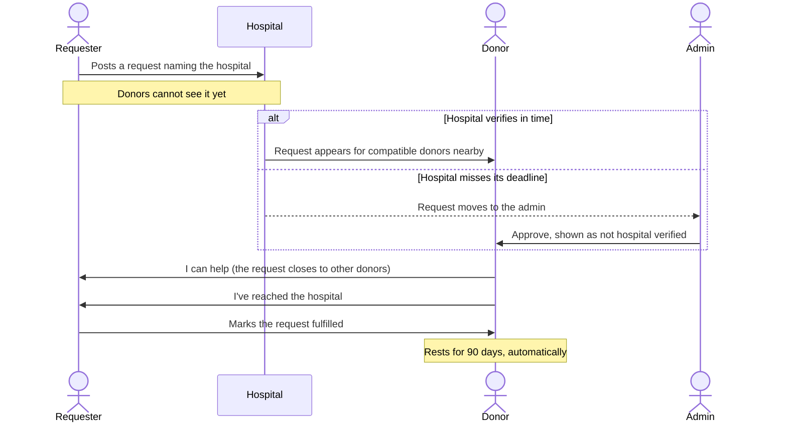

And the life of the request itself:

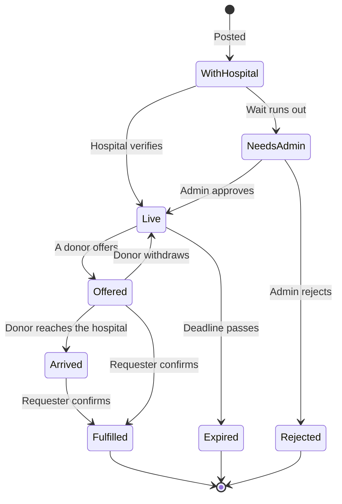

---

## See it

> All screenshots show **fake demo data**.

### 1. Someone needs blood

A requester gives the patient, blood type, units, urgency and hospital. Donors cannot see it yet, and the page says so.

<p align="center">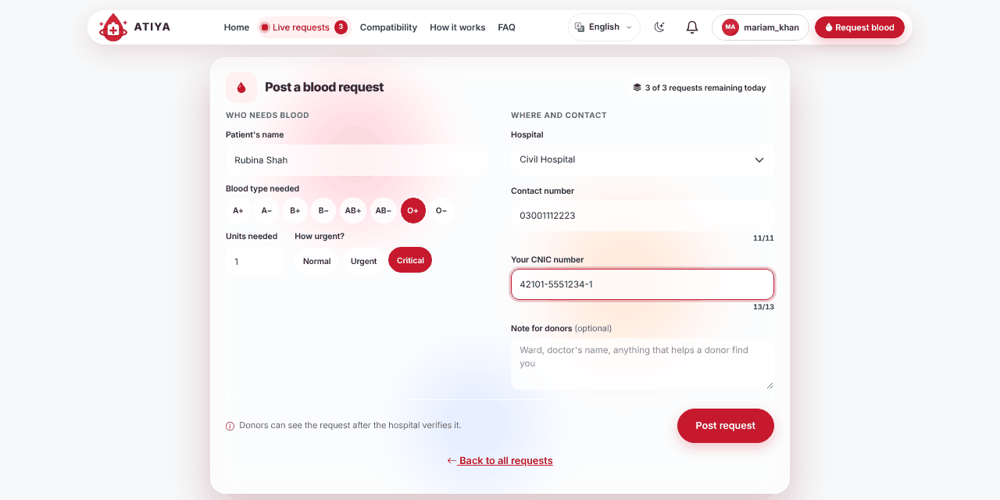</p>

### 2. The hospital checks it

Every hospital has its own login and sees only its own requests. One button verifies. If the hospital is slow, the request goes to an admin instead.

<p align="center">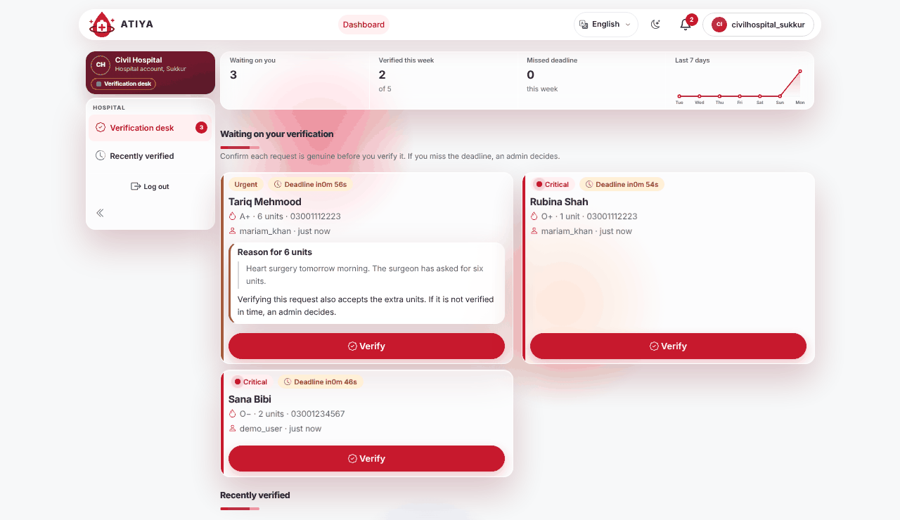</p>

### 3. The right donors see it

A donor sees only the requests they can actually help with: compatible blood type, same city, not their own, and not while resting.

<p align="center">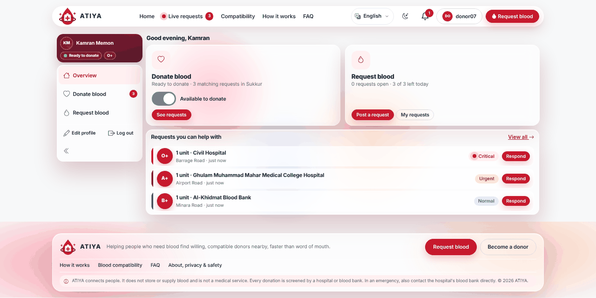</p>

### 4. The requester can follow it

One donor offers. The requester sees who is coming and, with a single tap from the donor, when they have reached the hospital. No live location, so the donor's whereabouts stay private.

<p align="center">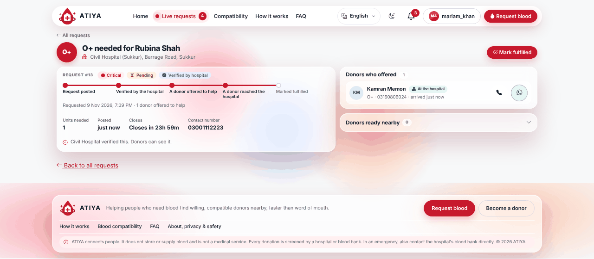</p>

### 5. Admins handle what falls through

Requests the hospital did not verify in time, and requests asking for more units than the limit, wait here. An admin approves or rejects, and every action is written to an audit log.

<p align="center">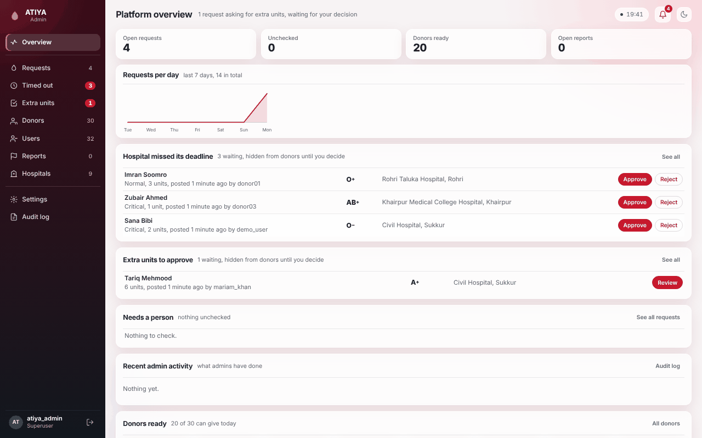</p>
<p align="center">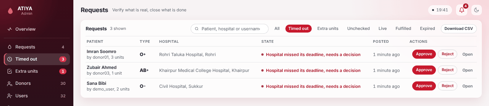</p>

### Built for Sukkur

<table>
  <tr>
    <td width="42%">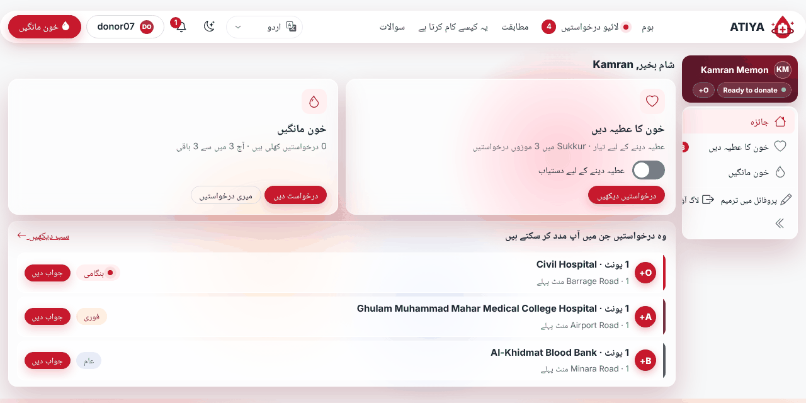<br><sub><b>Urdu and Sindhi</b>, mirrored right to left</sub></td>
    <td width="42%">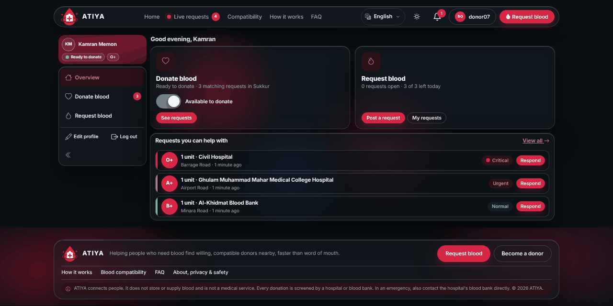<br><sub><b>Dark mode</b>, remembered between visits</sub></td>
    <td width="16%">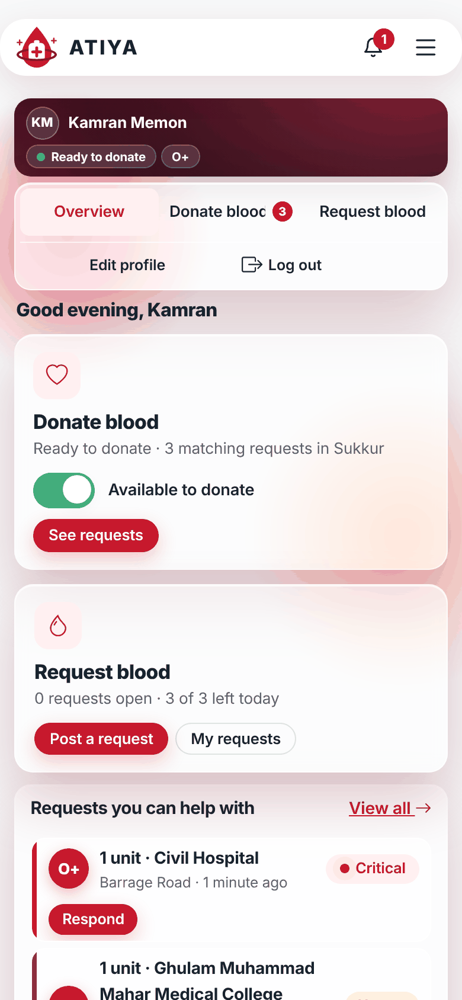<br><sub><b>Phones</b></sub></td>
  </tr>
</table>

---

## Rules that keep it safe

| Rule | How it works |
|---|---|
| **Hospital first** | A request stays hidden from donors, the public board and the home page until its hospital verifies it |
| **Blood compatibility** | Standard chart (O− gives to everyone, AB+ receives from everyone), checked against all 64 combinations in the tests |
| **Rest period** | 90 days after a donation, started automatically when a request is fulfilled |
| **One at a time** | One donor per request, and one active offer per donor. If a donor withdraws, the request opens again |
| **Hospital deadline** | Set per urgency in the admin Settings, from 1 minute to 1 day. After it, an admin decides |
| **Extra units** | More units than the limit (starts at 4) needs a reason. A hospital that verifies accepts the extra units. Otherwise an admin decides |
| **Expiry** | A request closes itself after 24 hours (Critical), 48 (Urgent) or 72 (Normal) |
| **Daily limit** | Three requests per user per day |
| **No self-dealing** | Nobody can offer on their own request, and hospital staff cannot verify a request they posted |
| **Honest labels** | A request an admin approved after a missed deadline is never shown as hospital verified |

<details>
<summary><b>Security and privacy details</b></summary>

- **Passwords** are hashed by Django. **CSRF protection** covers every form.
- **CNIC numbers** are not stored. ATIYA keeps a keyed one-way hash, so one CNIC cannot open two accounts, and only the last four digits for display.
- **Contact numbers** are hidden from signed-out visitors. A requester's number is shown to the requester, the hospital on the request, admins, and the one donor who offered.
- **Roles are kept apart.** Admins stay in the admin panel and hospitals in their own desk. A hospital sees only its own requests.
- **Idle logout:** admin and hospital accounts are signed out after 30 minutes of inactivity.
- **Abuse controls:** a report button, user blocking, and an audit log of every admin action.
- **Production:** with `DJANGO_DEBUG=0`, session and CSRF cookies are marked secure.

Please do not enter real patient data in a demo. This is coursework, not a medical system.

</details>

<details>
<summary><b>What each role can do</b></summary>

| Role | Can do |
|---|---|
| **Donor** | Register with blood type and city, switch availability on or off, see matching requests, offer to help, withdraw, say "I've reached the hospital", see when the rest period ends |
| **Requester** | Post a request, follow it on a timeline, see the donor who offered and their number, mark it fulfilled, report a request that looks fake |
| **Hospital staff** | See and verify requests naming their hospital, get notified at each step |
| **Admin** | Approve or reject timed-out and extra-unit requests, manage users, hospitals and reports, change settings, download CSV, read the audit log |

</details>

---

## Design decisions

**Why does the hospital come first?** A hospital knows whether a patient is really there. Asking donors to judge that from a forwarded message does not work. The admin is the fallback, never the first stop.

**Why one donor per request?** If everyone who sees a request offers, several people arrive for one patient and others never find out they were needed. One offer closes the request to others, and withdrawing opens it again.

**Why "I've reached the hospital" and not live location?** The requester only needs to know the donor arrived. Tracking someone's position is sensitive and not needed to solve that problem.

**Why is the rest period automatic?** People forget their last donation date. When the requester confirms the donation, ATIYA records it and stops showing that donor new requests for 90 days, with the date they are free again.

**Why label admin-approved requests?** An admin approving a request the hospital missed is a safety net, not the same as a hospital confirming a patient. The label keeps that difference visible.

---

## Run it in two minutes

You need **Python 3.12 or newer** (`python --version`, or `py --version` on Windows).

```bash
git clone https://github.com/Harsha-Talreja/atiya-blood-network.git
cd atiya-blood-network

python -m venv venv
venv\Scripts\activate              # Windows
# source venv/bin/activate         # macOS / Linux

pip install -r requirements.txt
python manage.py migrate
python manage.py set_hospital_logins --password "ChooseAPassword1!"
python manage.py createsuperuser
python manage.py runserver
```

Open **http://127.0.0.1:8000/**.

<details>
<summary><b>Windows tips</b></summary>

- **"Python was not found":** use `py -m venv venv` for that one command. Once the venv is active, plain `python` works.
- **PowerShell blocks activation:** run `Set-ExecutionPolicy -Scope Process -ExecutionPolicy Bypass` in that window, then activate again.
- **`No module named 'django'`:** the venv is not active. Look for `(venv)` at the start of the prompt.

</details>

<details>
<summary><b>Accounts and hospital logins</b></summary>

| Who | How the account is made |
|---|---|
| Donor and requester | Sign up on the site. Any account can post a request |
| Hospital | Created by `migrate`, renamed by `set_hospital_logins` (password is the one you choose) |
| Admin | `python manage.py createsuperuser`, then open `/admin-panel/` |

| Hospital | Username |
|---|---|
| Civil Hospital (Sukkur) | `civilhospital_sukkur` |
| Civil Hospital Khairpur | `civilhospital_khairpur` |
| Khairpur Medical College Hospital | `khairpurmedical_khairpur` |
| Rohri Taluka Hospital | `rohritaluka_rohri` |
| Shikarpur Civil Hospital | `shikarpurcivil_shikarpur` |
| Chandka Medical College Hospital | `chandkamedical_larkana` |
| Ghotki Civil Hospital | `ghotkicivil_ghotki` |
| Al-Khidmat Blood Bank | `alkhidmat_sukkur` |
| Ghulam Muhammad Mahar Medical College Hospital | `gmmmc_sukkur` |

For a pre-filled site, `python manage.py seed_demo_data` adds 30 fake donors, a demo requester and 12 fake requests (password `Demo@12345`). `--reset` removes only those.

</details>

<details>
<summary><b>Try the whole flow in five minutes</b></summary>

Use one normal window and two private windows so the logins do not overwrite each other.

1. **Donor:** sign up, complete the profile (blood type **O+**, city **Sukkur**).
2. **Requester:** sign up with another account, post a request for **O+** at **Civil Hospital**.
3. **Hospital:** log in as `civilhospital_sukkur` and press **Verify**.
4. **Donor:** refresh, press **I can help**, then **I've reached the hospital**.
5. **Requester:** open **My requests**, watch the timeline, press **Mark as fulfilled**.
6. **Admin:** in **Settings** set the hospital wait to 1 minute, post a request nobody verifies, and watch it appear under **Timed out**.

</details>

<details>
<summary><b>Tests, commands and settings</b></summary>

```bash
python manage.py test
```

| Command | What it does |
|---|---|
| `python manage.py check_requests` | Lists every request, where it is now and why |
| `python manage.py clear_test_users` | Shows what would be removed. Add `--yes` to remove donor and requester accounts. Admins and hospitals stay |
| `python manage.py make_admin USERNAME` | Makes an existing account an admin |
| `python manage.py set_hospital_logins` | Gives hospitals readable usernames and one password you choose |
| `python manage.py escalate_requests --every 60` | Optional: sends admin notifications on time when nobody has the site open |

| Environment variable | Purpose |
|---|---|
| `DJANGO_SECRET_KEY` | Signing key. Set your own on any real site. The CNIC hash depends on it, so do not change it later |
| `DJANGO_DEBUG` | `0` turns debug off |
| `DJANGO_ALLOWED_HOSTS` | Comma-separated host names |
| `DJANGO_CSRF_TRUSTED_ORIGINS` | Comma-separated origins such as `https://example.com` |

The hospital wait per urgency and the maximum units per request are changed in the **admin panel Settings**, with no code.

</details>

<details>
<summary><b>Deploy for free on PythonAnywhere</b></summary>

`HOSTING-GUIDE.md` has every click. In short: upload, create a venv, `pip install -r requirements.txt`, `migrate`, `set_hospital_logins`, `createsuperuser`, `collectstatic --noinput`, set `DJANGO_SECRET_KEY`, `DJANGO_DEBUG=0` and `DJANGO_ALLOWED_HOSTS`, then reload the web app.

</details>

---

## Under the hood

| Layer | Choice |
|---|---|
| Language and framework | Python 3.12+, Django 6.1 |
| Database | SQLite |
| Front end | Server-rendered templates, Bootstrap 5, Bootstrap Icons, HTMX for small live updates. Every script, font and icon is bundled, so it runs without internet |
| Languages | Django translations (English, Urdu, Sindhi) with a mirrored right-to-left stylesheet |
| Tests | Django's test runner, 883 tests |
| Hosting | PythonAnywhere (any WSGI host works) |

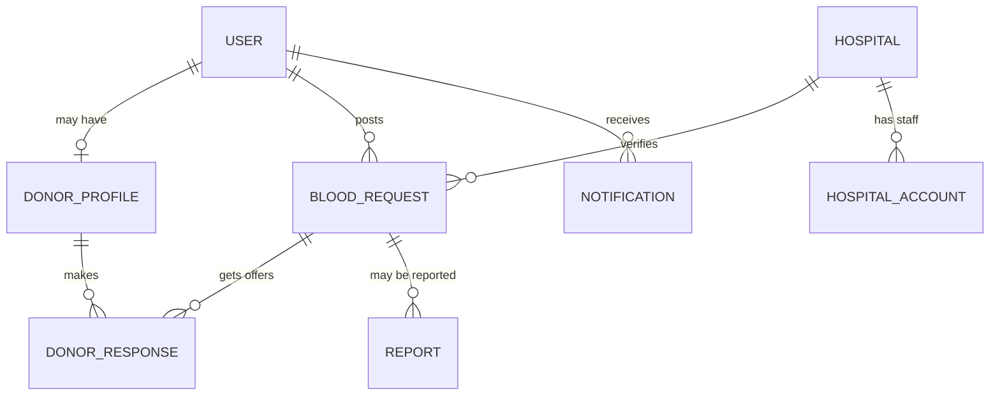

<details>
<summary><b>Project structure</b></summary>

```
.
├── config/           settings and main URLs
├── core/             home page, blood compatibility, shared constants, demo data
├── accounts/         signup, login, identity handling
├── donors/           donor profiles, availability, eligibility
├── blood_requests/   requests, matching, offers, timeline, reports
├── hospitals/        hospital list, logins, verification desk
├── siteadmin/        admin panel, settings, audit log
├── notifications/    in-app notifications
├── templates/        HTML templates
├── static/           CSS, JavaScript, bundled libraries
├── locale/           Urdu and Sindhi translations
├── docs/images/      README images
├── manage.py
└── requirements.txt
```

</details>

<details>
<summary><b>Editing the translations</b></summary>

Wording lives in `locale/ur/LC_MESSAGES/django.po` and `locale/sd/LC_MESSAGES/django.po`. After editing a `msgstr`, rebuild with `python manage.py compilemessages` (needs GNU gettext) or `pip install babel` and `pybabel compile -d locale`. Keep every `%(name)s` exactly as in the English line. After editing `static/css/theme.css`, regenerate the right-to-left copy `theme.rtl.css`.

</details>

---

## Questions people ask

<details>
<summary><b>Why would someone donate through ATIYA?</b></summary>

ATIYA does not pay or reward donors. The reason to donate is the same as anywhere: a patient needs blood. What ATIYA changes is the effort. A donor is only shown requests they can really help with, is never asked while resting, can trust that a hospital has checked the request, and can see the date they are free to donate again.

</details>

<details>
<summary><b>What if the hospital never verifies a request?</b></summary>

After the hospital's deadline, the request moves to an admin, who approves or rejects it. If it is approved, donors see it labelled "not hospital verified".

</details>

<details>
<summary><b>What if two donors offer at once?</b></summary>

The first offer closes the request to everyone else. A second donor sees a short message instead of the button. If the first donor withdraws, it opens again.

</details>

<details>
<summary><b>Does ATIYA track where a donor is?</b></summary>

No. The donor taps "I've reached the hospital". That is all the requester and the hospital learn.

</details>

<details>
<summary><b>Who can see a requester's phone number?</b></summary>

The requester, the hospital named on the request, admins, and the one donor who offered. Signed-out visitors never see it.

</details>

<details>
<summary><b>Can a requester edit or cancel a request?</b></summary>

Not yet. A requester can mark it fulfilled, and an admin can remove it.

</details>

---

## What is next

- Edit and cancel for requesters
- Email or SMS alerts, so donors do not need the site open
- A separate password per hospital instead of one shared demo password
- Native-speaker review of the Urdu and Sindhi wording, which was prepared with AI help
- Translating the admin panel and notification text

---

## Documentation

| | |
|---|---|
| [`HOSTING-GUIDE.md`](HOSTING-GUIDE.md) | Step-by-step deployment to PythonAnywhere |
| [`PROJECT_CONTEXT.md`](PROJECT_CONTEXT.md) | Architecture, data model and build order |
| [`AI_USAGE.md`](AI_USAGE.md) | What AI tools did in this project and what the team did by hand |

## Team

*(Add the three team members' names and roll numbers here.)*

CSC-206 Software Engineering, Aror University of Art, Architecture, Design & Heritage, Sukkur.

## Licence

A university coursework project. No open-source licence has been chosen yet, so all rights stay with the authors until one is added.
